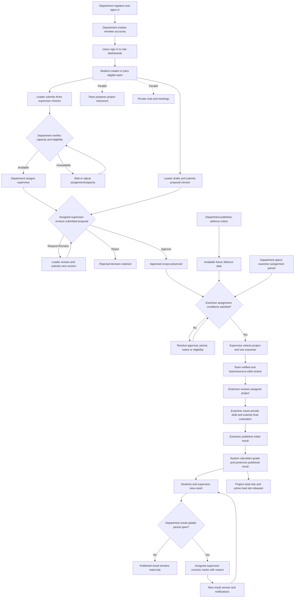
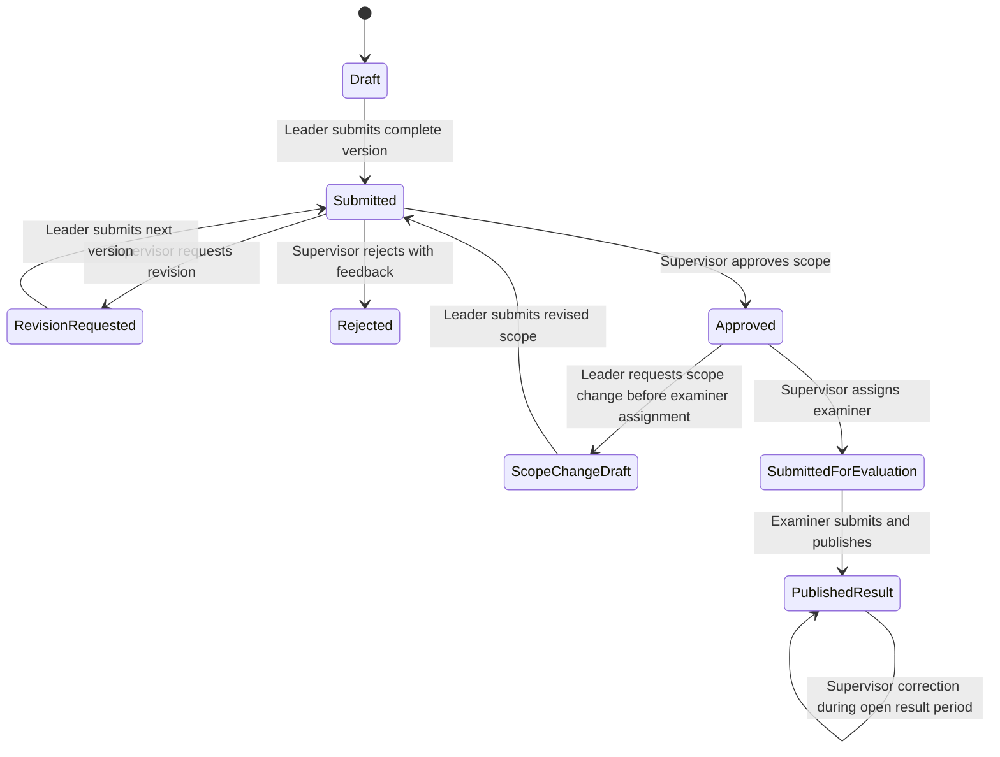
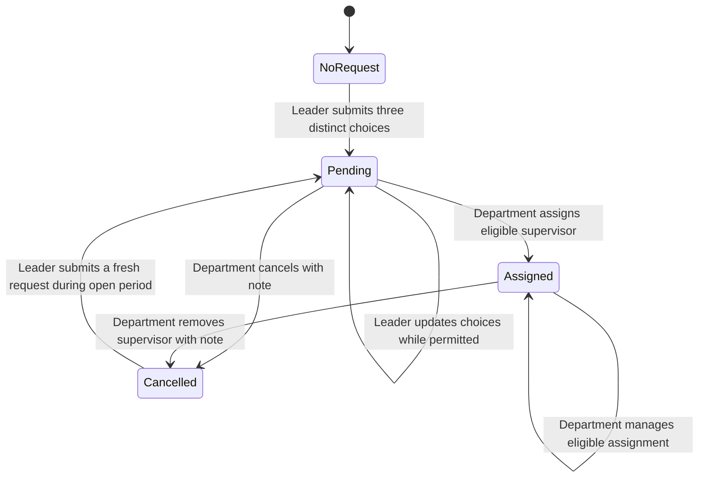
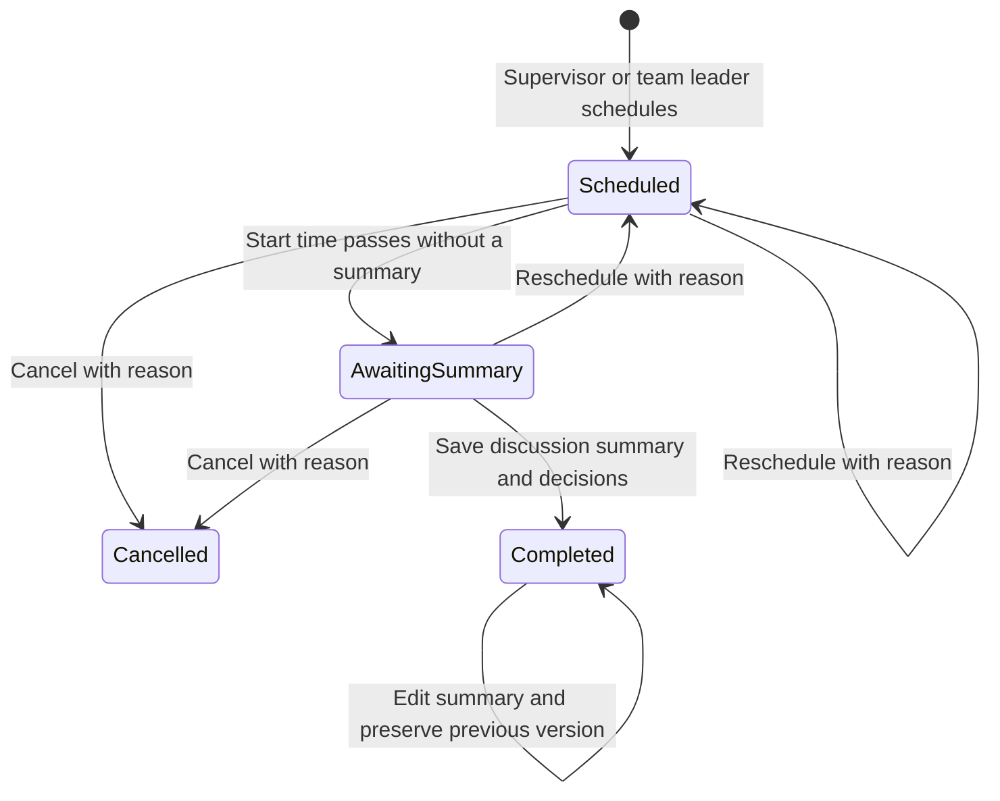
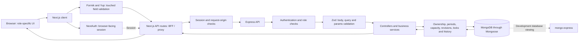

# Synoria — Complete Project Workflow

**Purpose:** A self-contained reference for creating workflow diagrams, swimlanes, state diagrams and a system architecture visual in ChatGPT.

**Implementation reference date:** 28 October 2026. This describes the current application, not the original assignment brief and not the live status of any department's database.

**Product:** Synoria — Final-Year Project, Thesis and Research Supervision Portal.

## 1. Ready-to-use prompt for ChatGPT

Copy this prompt and attach this entire Markdown file:

> Act as a systems analyst and information designer. Read the attached Synoria workflow document as the source of truth. Create a clear visual explanation of the implemented system for a university final-year project presentation.
>
> Produce these separate visuals:
>
> 1. A high-level end-to-end swimlane diagram with Department / Coordinator, Student Team, Assigned Supervisor and Assigned Examiner. Include system actions as a separate lane or clearly marked nodes.
> 2. A team and supervisor-selection flow, including invitation/join requests, three ranked supervisor choices, capacity checks, assignment and cancellation with a reason.
> 3. A proposal-to-result flow showing revision loops, approved scope versions, examiner assignment, editing locks, one-time examiner submission and supervisor-only result corrections.
> 4. A collaboration visual showing chat messages and system updates in one chronological timeline, with a meeting panel on the right and versioned meeting summaries.
> 5. A compact architecture diagram showing Browser, Next.js client/BFF, NextAuth, Express API, validation/services and MongoDB.
>
> Use short English labels, numbered phases, labelled decision branches, solid arrows for the primary process and dashed arrows for notifications or parallel collaboration. Give each role a consistent colour. Use a clean academic presentation style with Synoria's blue/purple accents and readable text. Split complex flows into multiple diagrams instead of making one crowded poster. Include a small legend for actions, decisions, notifications, locked states and preserved history.
>
> Preserve all permissions and conditions in this document. Department and Coordinator are the same account role. Students are team members; the team leader has additional permissions. Do not invent features or restore removed modules. Resource preparation and collaboration can run in parallel with proposal/supervision work. Department periods are independent gates, not mandatory sequential stages.
>
> Especially show that a supervisor, rather than the department, assigns the examiner; team/resource changes lock at examiner assignment; examiner submission is final; only the assigned supervisor can correct a published result while the department's Result Update period is open. Result Update notices also reach examiners, but that does not give them editing permission.
>
> Use the Mermaid examples as structural references. Provide renderable Mermaid versions alongside the visuals. If image generation or rendering is unavailable, provide the complete diagram code and a precise layout specification. Finish with a short presentation explanation of the full lifecycle.

## 2. Actors and ownership

| Actor | Responsibility | Scope |
| --- | --- | --- |
| Department / Coordinator | Creates member accounts, controls periods and notices, manages supervisor requests/capacity, publishes defence notices and monitors results. | Its own department. This is one account role, not two separate roles. |
| Student — Team Leader | Creates/manages the team, submits three supervisor choices, edits/submits the proposal, maintains resources and manages meetings. | Their own team/project. |
| Student — Team Member | Joins a team, participates in chat, maintains resources, views proposals/results and attends meetings. | Their own team/project. Cannot submit supervisor choices or manage meetings. |
| Assigned Supervisor | Supervises multiple teams, reviews proposals, chats, manages meetings, assigns examiners and conditionally corrects published results. | Currently assigned teams/projects. |
| Assigned Examiner | Views assigned evaluation projects and their materials, scores the rubric, submits evaluation and publishes the initial result. | Projects explicitly assigned to that examiner. |
| System | Enforces access, periods, capacity, locks, grading, history and notification delivery. | Server-side rules remain authoritative. |

**Ownership model:** Department → member accounts → team/workspace → one project/proposal with versions → supervisor assignment → examiner assignment/evaluation → published result.

A team/workspace is the shared project container. Project, thesis and research are supported work types.

## 3. Current portal navigation

| Portal | Main menu items, in order |
| --- | --- |
| Department | Dashboard; Supervisors; Supervisor Loads; Manage Supervision; Students; Examiners; Proposals; Project Resources; Defence Schedules; Examiner Control; Results. |
| Student | Dashboard; Chat; Team; Supervisor; Project Resources; Proposal; Defence Schedules; Results. |
| Supervisor | Dashboard; Chat; Assigned Projects; Proposals; Project Resources; Defence Schedules; Examiner Assignment; Results. |
| Examiner | Dashboard; Defence Schedules; Evaluation. |

Account/profile, notification bell and theme controls are in the top navigation. Invitations and joining requests are inside **Team**. Meetings are inside **Chat**, not a separate sidebar module.

## 4. Independent department-controlled periods

Each period has its own status, deadline and notice. **Open** allows the relevant action before the deadline. **Paused**, **Closed** or an expired deadline blocks that action. Existing readable data/history is preserved. New periods default to Closed.

| Control | Department manages it from | What it permits | Notice audience |
| --- | --- | --- | --- |
| Supervisor Choice Period | Manage Supervision | Team leader submits/updates three supervisor preferences while unassigned. | Department users across the supported roles. |
| Proposal Period | Proposals | Team leader saves proposal drafts and submits eligible versions. | Department users across the supported roles. |
| Resource Update Period | Project Resources | Current team members add/edit/remove eligible resources. | Department users across the supported roles. |
| Examiner Assignment Period | Examiner Control | Assigned supervisor submits an approved project to an examiner. | Supervisors only. |
| Result Update Period | Results | Assigned supervisor corrects an already published result. | Supervisors and examiners only. |

Important distinctions for the visual:

- Opening a resource period does **not** override the lock caused by examiner assignment.
- Removing a supervisor does **not** bypass a closed supervisor-choice period; a new request still needs an open period.
- The examiner-assignment period controls assignment, not an examiner's later scoring session.
- The result-update period controls corrections to published results, not initial examiner scoring/publication.
- Chat and meetings do not depend on the proposal/resource periods. Completed projects remain read-only.
- Publishing/updating notices creates notifications; notice visibility does not grant write permissions.

## 5. End-to-end business workflow

### Phase A — Account setup and sign-in

1. A department creates its account and signs in.
2. The department creates supervisor, student and examiner accounts, with initial credentials.
3. Users choose their role on the account-selection screen and sign in.
4. The system opens the role-specific dashboard and enforces department isolation.
5. The department can view, edit, deactivate/reactivate or delete member accounts. Account changes affect access; existing project history is preserved.

### Phase B — Team formation

1. A student without a conflicting team/project creates a team and becomes its leader.
2. The leader can directly add eligible department students or send invitations.
3. Eligible students can also request to join a team.
4. The leader accepts/declines joining requests; invited students accept/decline invitations. Pending requests/invitations can be cancelled by the authorised party.
5. The leader assigns each member a responsibility from a dropdown.
6. Members may leave; the leader may remove members. The leader stays with the team.
7. Examiner assignment or project completion locks team changes.

**Identity rule:** A student can belong to only one active team. Once participation in a project/proposal is recorded, leaving or completing it does not create eligibility for a second project. Revisions belong to the same proposal; they are not new projects.

**Responsibility options:** Team Lead, Researcher, Literature Reviewer, Methodology Lead, Data Collector, Data Analyst, Experiment Lead, Frontend Developer, Backend Developer, Full Stack Developer, UI/UX Designer, QA Tester, Documentation Lead, Presentation Lead and Member.

The displayed responsibility is separate from ownership: choosing “Team Lead” in a responsibility dropdown does not transfer the actual team-leader account permission.

### Phase C — Supervisor selection and assignment

1. The department opens the Supervisor Choice Period with a notice and deadline.
2. The team leader ranks exactly three different active supervisors: First, Second and Third Choice.
3. One request represents the entire team; members can view it.
4. The department reviews requests in Manage Supervision.
5. The department chooses a supervisor from the team's preferences, subject to capacity and account eligibility.
6. The assignment applies to the whole team/project and consumes one active-project slot.
7. The department can adjust capacity from Supervisor Loads.
8. A pending request may be cancelled with a required note.
9. An assigned supervisor may be removed with a required cancellation note. The request becomes Cancelled, rather than silently returning to Pending.
10. The team receives the note, sees why it was cancelled and can submit a fresh request during an open choice period. Earlier cancellation history remains available.

A supervisor may supervise multiple teams. Capacity counts active assigned projects, including proposals awaiting review. Publication/completion releases the active load slot while retaining history.

### Phase D — Proposal drafting, submission and review

1. The department opens the Proposal Period and publishes its notice/deadline.
2. The team leader prepares the work type, title, abstract, research area and supervisor preference. Ranked preferences, when present, feed the proposal preference.
3. Incomplete drafts can be saved. Submission requires complete eligible data and resolved pending invitations.
4. Submission creates an immutable proposal version with its team/preference snapshot.
5. The currently assigned supervisor reviews the submitted version. Drafting/submission can happen before actual supervisor assignment; an unassigned submission waits for department assignment before review.
6. The decision is Approve, Request Revision or Reject. Rejection/revision requires feedback.
7. Request Revision enables editing/resubmission of a new version when the Proposal Period permits it. Earlier versions remain unchanged.
8. Approval saves the approved scope/version and enables the project to become eligible for examiner assignment.
9. An approved proposal can enter a scope-change cycle before examiner assignment, with a reason and a newly reviewed version. The last approved scope remains preserved.

The work type cannot be changed after the first proposal submission.

**Rejected is not the revision loop.** The normal resubmission path is Request Revision. Do not draw automatic creation of another project, or an automatic rejected → new proposal transition.

Preference and actual assignment are different: selecting a preferred supervisor does not itself assign them. Supervisor assignment remains department-controlled. Manage Supervision is the primary ranked-request workflow; the department proposal detail also retains an assignment-management action for submitted proposals.

### Phase E — Project resources

This can run in parallel with proposal work after a team exists; proposal approval is not a prerequisite for preparing resources.

1. The department opens the Resource Update Period with its notice/deadline.
2. Team members maintain repository links, useful links and uploaded files.
3. File categories include Report, Presentation, Poster, Dataset, PDF and Other.
4. Files can be downloaded by authorised users. Valid PDFs can also be viewed in the application.
5. The assigned supervisor is notified when team members add, edit or remove a resource. Important changes also enter team chat history.
6. Supervisors view resources for their assigned projects. Examiners access assigned-project resources through Evaluation, without a separate resources sidebar menu.
7. The department can review resources and remove eligible items before examiner assignment.
8. Examiner assignment locks resource changes. Reopening the resource period does not unlock them. Authorised viewing/downloading remains available.

Current upload limits: up to 5 MB per file and up to 30 resources per project. Resource edits are not a restored versioned-deliverables/submission module.

### Phase F — Defence notice and examiner assignment

1. The department publishes an upcoming Defence Notice: **Batch, Stream, Date, Time and Venue**.
2. Defence Schedules acts as a notice board for department users.
3. The department opens the Examiner Assignment Period from Examiner Control. Its notice is sent only to supervisors.
4. A supervisor opens Examiner Assignment and selects the correct team/project from their assignments.
5. The system requires a currently approved proposal/scope, an eligible active project and an open assignment period.
6. The supervisor chooses **one active examiner** and an available published future defence notice/date.
7. The system checks the selected notice/revisions and scheduling conflicts, then saves the assignment and approved proposal/team snapshot.
8. The team is notified that the project was submitted for evaluation.
9. Team changes and project-resource editing become locked. This is the key lock point in the main visual.
10. The assigned examiner now sees the project in Evaluation and can open its approved proposal, team, supervisor and resources.

The department manages accounts, notices and the assignment period; the assigned supervisor performs examiner assignment. An existing evaluation assignment cannot simply be replaced through the new submission flow. A defence notice already used by an active evaluation is protected against casual edits/removal.

### Phase G — Examiner evaluation and initial result

1. An examiner initially has no evaluation projects until explicitly assigned.
2. The examiner opens an assigned project and reviews its materials.
3. The system uses a saved rubric snapshot. The examiner can save an incomplete draft privately.
4. When all criteria are complete, the examiner submits the evaluation.
5. Submission is final for the examiner: they cannot edit, resubmit or reopen it.
6. After submission, the examiner publishes the initial result, confirming that the defence has taken place and evaluation is complete, with an optional publication note.
7. The system calculates the weighted final mark, letter grade and grade point.
8. Students and their assigned supervisor can see the published result and receive notifications.
9. The project is treated as completed/read-only; its history remains accessible and its active supervisor load slot is released.

**Submit Evaluation and Publish Result are distinct actions in the current interface.** Do not merge them into one automatic step in the visual. Private drafts/unpublished grading details are not shared into student chat.

### Phase H — Published result corrections

1. The department opens the Result Update Period with a notice and deadline from Results.
2. Supervisors and examiners receive the notice.
3. Only the currently assigned supervisor can change a published result.
4. The supervisor enters revised marks and a required correction reason.
5. The system recalculates the grade/grade point, preserves the previous published version and records who changed it and when.
6. The updated result becomes visible and notifications are generated for relevant recipients.
7. The supervisor may make further corrections while the period remains open and unexpired.
8. Pausing/closing the period or passing its deadline blocks corrections.

The examiner never regains editing permission. Corrections change the final published mark; the original examiner rubric assessment remains intact. Correcting a result does not reopen team/resource editing or normal project collaboration writes.

## 6. Main workflow diagram reference

Collaboration and resource preparation are parallel tracks; they are not extra approval gates.



## 7. Proposal and supervisor-request state references

### Proposal state flow



The proposal period gates draft writes and resubmission. The approved scope is preserved during scope-change review. Rejected is retained without an automatic retry arrow.

### Ranked supervisor request flow



Examiner assignment/completion prevents supervision/team changes. Cancellation records are preserved; a cancelled request cannot simply be assigned again without a fresh request.

## 8. Private chat and chronological system updates

- Students open Chat directly into their own conversation.
- Supervisors select a conversation because they may supervise several teams.
- Only current team members and the currently assigned supervisor can access team chat. Department/examiner roles do not get private-chat access.
- Messages and major team events share one timeline ordered by time, with stable identities and older-history pagination.
- Team events include supervisor requests/assignments/cancellations, proposal submission/review, team/resource changes, examiner submission, result publication/correction and meeting events.
- Personal account/capacity notices and supervisor-only department control notices are not indiscriminately copied into team chat.
- A completed project's conversation remains readable; normal messaging/meeting changes are disabled.

Example sequence for a collaboration visual:

```text
09:00  Student: “Hi, we have uploaded the report.”
09:02  SYSTEM: Project Resources Updated
09:05  Supervisor: “Let's discuss the results.”
09:07  SYSTEM: Meeting Scheduled — tomorrow, 10:00, Faculty Room
Next day
10:40  SYSTEM: Meeting Summary Updated — discussion and decisions
10:42  Student: “We will make the agreed changes.”
```

These times are illustrative, not a real schedule.

## 9. Meeting workflow inside the conversation

### Layout

- Desktop: conversation/messages in the main area; a meeting panel on the right.
- Mobile: a Meetings button opens the panel in a dialog.
- Panel tabs: Upcoming and History.
- Meeting details include schedule, supervisor, agenda, venue/link, current summary and the meeting's complete change history.
- A system card's View Details action can open the corresponding meeting.

### Permissions and lifecycle

1. The assigned supervisor or actual team leader schedules a meeting. Other members view it.
2. Scheduling requires an active assigned supervisor and a project that is not completed.
3. Fields: title, agenda, future date/time, duration and venue and/or HTTP(S) meeting link.
4. Meeting times are entered/displayed in Bangladesh time; duration is 15–240 minutes.
5. Overlapping meetings for the same team or supervisor are rejected.
6. Schedule creation, rescheduling and cancellation are preserved and added to chat/notifications. Reschedule/cancel needs a reason.
7. Once the scheduled start time has passed, a manager can add the discussion summary and decisions/next steps. The interface is not an attendance-verification system.
8. Saving a summary marks the meeting Completed. Either authorised manager can edit the summary later while the project remains writable.
9. Each edit preserves earlier summary versions, author and timestamp. Each summary update also appears chronologically in chat.
10. Completed meetings cannot be rescheduled/cancelled; their summaries can be corrected. Cancelled meetings are read-only; schedule a new meeting instead.



**Awaiting Summary is a displayed state:** the stored status remains Scheduled until summary completion or cancellation. Project completion overrides all meeting write permissions.

## 10. Permission and locking matrix

All permissions additionally require a valid account, matching department and relevant ownership/assignment.

| Action | Department | Team leader | Other team member | Assigned supervisor | Assigned examiner |
| --- | --- | --- | --- | --- | --- |
| Create/edit/manage member accounts | Yes | No | No | No | No |
| Control periods and notices | Yes | No | No | No | No |
| Manage supervisor capacity/assignment | Yes | No | No | No | No |
| Submit three supervisor choices | No | Open choice period, eligible team | No | No | No |
| Manage team membership/responsibilities | No through student team controls | Before examiner lock | Own eligible invitation/join/leave actions | No | No |
| Draft/submit proposal | No | Open proposal period, eligible state | View | Review assigned submission | View assigned approved scope |
| Add/edit resources | No | Open resource period, before examiner lock | Same conditions | View assigned resources | View assigned resources |
| Remove an eligible resource | Before examiner lock | Open resource period, before lock | Same conditions | No | No |
| Private team chat | No | Own conversation | Own conversation | Assigned conversations | No |
| Schedule/change meetings | No | While eligible project writable | View only | While eligible project writable | No |
| Add/edit meeting summary | No | After start, writable project | View only | After start, writable project | No |
| Publish defence notice | Yes | View | View | View | View |
| Assign examiner | Controls the period/accounts | No | No | Eligible approved project + open period + published date | No |
| Draft/submit examiner evaluation | No | No | No | No | Assigned project; one final submission |
| Publish initial result | No | No | No | No | After complete submitted evaluation |
| Correct published final marks | Controls result period | No | No | Open result period, required reason | No |
| View published outcome | Department scope | Own project | Own project | Assigned project | Assigned evaluation |

**Lock summary:**

| Trigger | Effect |
| --- | --- |
| Proposal submission | That submitted version becomes immutable; editing depends on the revision/scope-change workflow. |
| Supervisor assignment | Team's submitted supervisor choices stop being editable until eligible cancellation/removal. |
| Examiner assignment | Team membership/responsibility changes and resource editing lock; approved evaluation scope/team are snapshotted. |
| Examiner evaluation submission | Examiner grading becomes final; it cannot be reopened. |
| Initial result publication | Project becomes read-only, including messaging/meeting writes; history remains readable and active supervisor capacity is released. |
| Result period opens | Only the assigned supervisor can correct published final marks; it does not unlock the project. |

## 11. Current evaluation and grading rules

New assignments use the default rubric unless an existing saved rubric snapshot applies. Existing evaluation snapshots are preserved.

| Default criterion | Weight |
| --- | --- |
| Problem Understanding | 15% |
| Methodology | 20% |
| Implementation / Research Quality | 30% |
| Report Quality | 20% |
| Presentation And Viva | 15% |

Each default criterion is scored out of 100. Final mark = sum of `(criterion marks / criterion maximum) × criterion weight`, rounded to two decimals. The current new-assignment flow uses one examiner. Criterion and overall feedback can accompany the assessment.

Current application's Bangladesh-style 4.00 scale:

| Final mark | Grade | Grade point |
| --- | --- | --- |
| 80–100 | A+ | 4.00 |
| 75 to below 80 | A | 3.75 |
| 70 to below 75 | A− | 3.50 |
| 65 to below 70 | B+ | 3.25 |
| 60 to below 65 | B | 3.00 |
| 55 to below 60 | B− | 2.75 |
| 50 to below 55 | C+ | 2.50 |
| 45 to below 50 | C | 2.25 |
| 40 to below 45 | D | 2.00 |
| Below 40 | F | 0.00 |

This is a project/evaluation grade point, not a calculation of semester CGPA. Before publication, result views show “Result Not Available Yet” rather than fabricated result data.

## 12. Architecture and request flow



- The browser uses the Next.js BFF; it does not receive the Express session cookie in public session data.
- The Express session identity is forwarded server-side by the BFF. Protected downloads and PDF viewing also require authorised access.
- Backend code is JavaScript in `server/src`; the client uses Next.js with JSX UI components.
- MongoDB stores accounts, team/proposal data, the supervision/evaluation ledger, resources/private files, messages, read cursors, meetings/activity history and notifications.
- Period/assignment writes use coordination and revision checks to avoid conflicting changes. Retry keys prevent duplicate actions.
- Chat refreshes through polling; notifications and meetings also refresh while relevant views are active. Do not label the current transport as WebSocket or Socket.IO.
- MongoDB and mongo-express are available through Docker Compose for local development. mongo-express is an administration tool, not an application role or a step in the student workflow.

## 13. What must not appear as current standalone features

Do not restore these older/removed modules in generated visuals:

- Milestones and overdue-work tracking.
- Reports & Deliverables / versioned submission and feedback modules.
- Final Submission checklist module.
- Searchable Project Archive portal.
- Standalone Meeting Logs menu/page. Current meetings belong inside Chat.
- Department Projects menu/page.
- Department Evaluation Rubrics menu/page. Internal rubric snapshots still support grading.
- Student Invitations menu. Invitations/join requests belong inside Team.
- Examiner Project Resources sidebar item. Assigned resources are reached through Evaluation.
- Examiner result editing, department publishing of the initial examiner result, or a submitted-evaluation reopen loop.
- Optional AI summaries, similarity checking, report-format checking or calendar integrations as if implemented.

“Archived/read-only” is an internal completion state with accessible history; it is not a restored searchable archive feature. Defence notice publishing and supervisor-led project-to-examiner assignment are distinct workflows.

## 14. Example narrative for a presentation

1. A department registers and creates its student, supervisor and examiner accounts.
2. A student creates Team Alpha; eligible classmates join and receive responsibilities.
3. During the open choice period, the leader ranks Supervisor A, B and C.
4. The department verifies capacity and assigns Supervisor B to the team.
5. During the proposal period, the leader submits Version 1. Supervisor B requests revisions; Version 2 is submitted and approved.
6. In parallel, team members maintain repository links and PDFs while the resource period is open. They discuss progress in chat and schedule a supervision meeting.
7. After the meeting, the leader or supervisor records the discussion and decisions. A summary correction preserves the earlier notes and appears in chat.
8. The department publishes the relevant defence notice and opens examiner assignments.
9. Supervisor B selects Team Alpha, one examiner and the published defence date. Team/resource changes lock and the students are notified.
10. The examiner reviews the project, submits a final evaluation and separately publishes the result after confirming the defence/evaluation is complete.
11. The students and supervisor view the result; the project is read-only and the active supervision slot is released.
12. If the department opens result corrections, Supervisor B can correct the published mark with a reason. The prior result remains in history. The examiner still cannot edit it.

## 15. Visual accuracy checklist

- [ ] Four account roles; leader/member permissions are shown within the student role.
- [ ] One active team and one project/proposal participation rule; revisions do not create another project.
- [ ] Three distinct supervisor choices are submitted once per team by its leader.
- [ ] Department assigns supervisors subject to capacity; cancellations include a note and lead to a fresh request.
- [ ] Proposal Request Revision is a loop; Reject is not silently treated as Request Revision.
- [ ] Parallel resource preparation and collaboration are not shown as extra approval gates.
- [ ] Department publishes a defence notice; assigned supervisor selects the project/date and assigns one examiner.
- [ ] Examiner assignment visibly locks team/resource changes.
- [ ] Examiner final submission and initial publication are separate; submitted grading cannot be reopened.
- [ ] Only assigned supervisors correct published results, gated by the department result period.
- [ ] Chat includes interleaved system events; meetings have a right-side panel and versioned summaries.
- [ ] Completed history remains readable; project write locks are not undone by result corrections.
- [ ] Removed features are absent; diagrams contain no credentials, real accounts or fabricated integrations.
